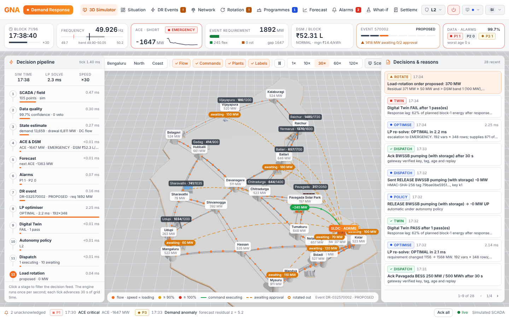
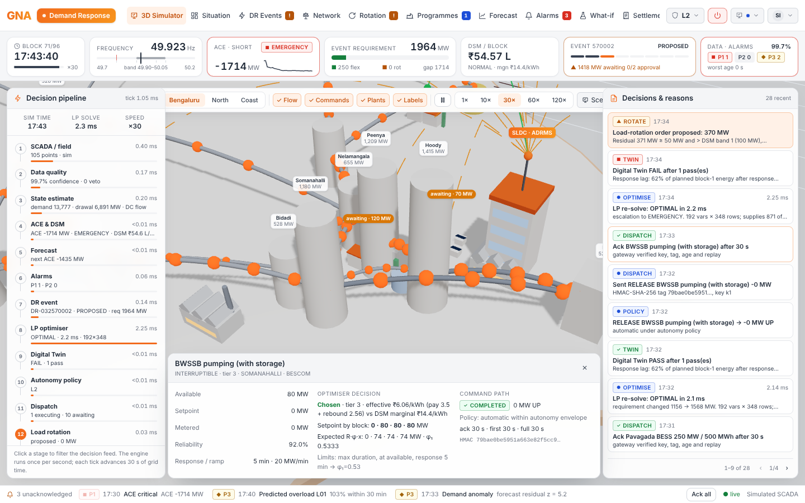
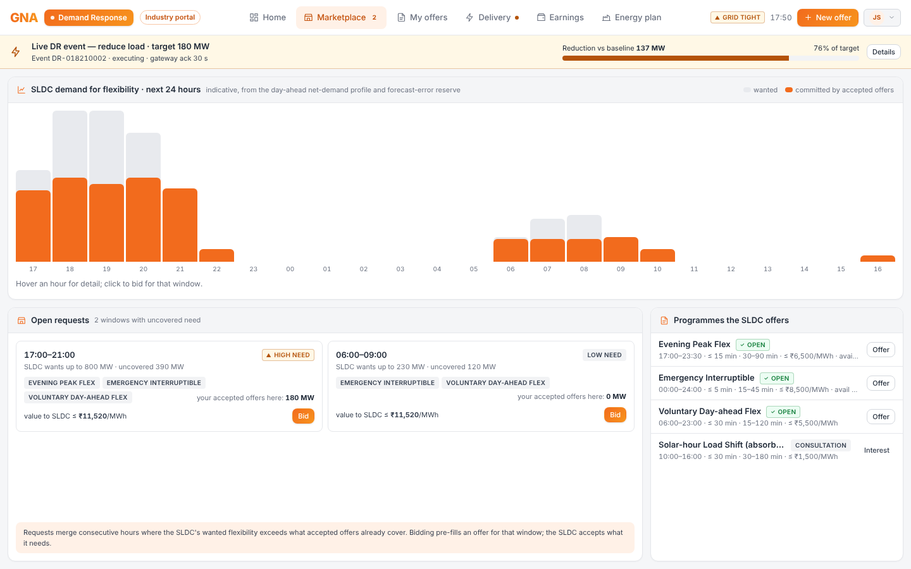
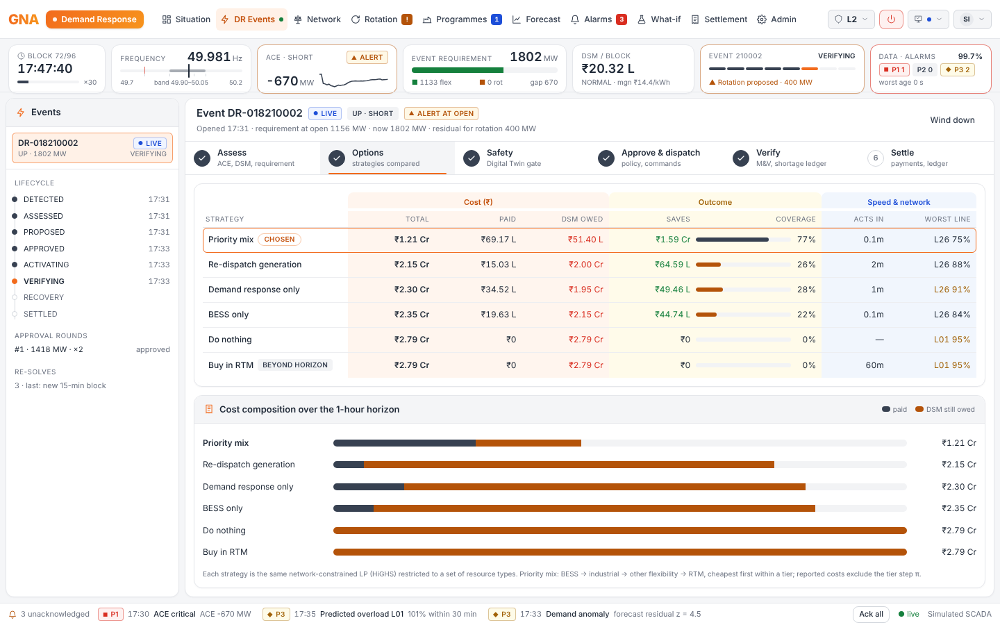
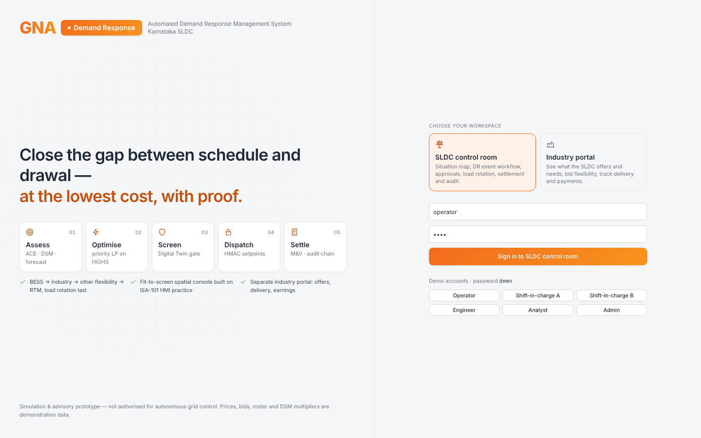
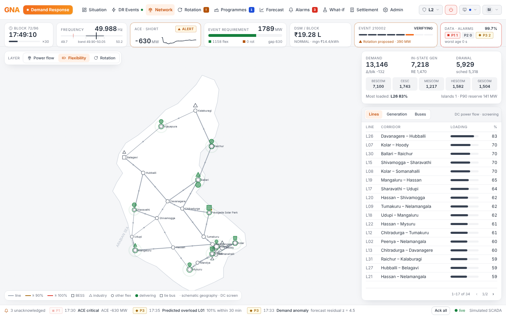
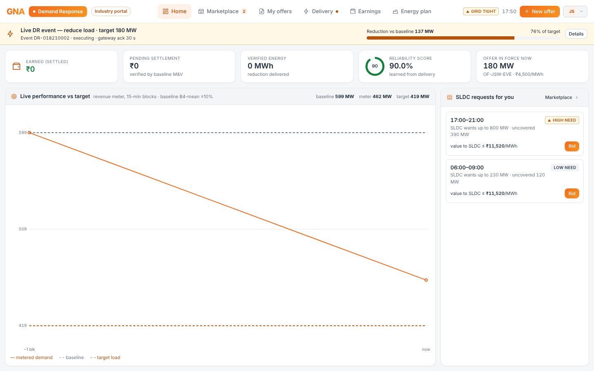

# GNA (Demand Response)

Automated Demand Response Management System (ADRMS) for a state control area (Karnataka / KPTCL SLDC).
It closes the gap between scheduled and actual drawal at the lowest cost, proves delivery and settles payment.
Load rotation is only the last resort.

> **Status: simulation and advisory prototype.** Not authorised for autonomous grid control. DSM multipliers,
> prices, participant bids, reliabilities, the frequency bias and the load-rotation roster are demonstration data.
> See [docs/HOW-IT-WORKS.md](docs/HOW-IT-WORKS.md) §13 for what is required before a utility pilot.



## What is in the box

| Part | Stack | Purpose |
| --- | --- | --- |
| `backend/` | Python 3.11+, FastAPI, numpy, HiGHS (`highspy`) | The ADRMS engine and API |
| `frontend/` | Next.js 16 (App Router), React 19, Tailwind 4, Three.js / React Three Fiber | SLDC control-room console and industry portal |
| `docs/HOW-IT-WORKS.md` | — | The specification: every calculation, threshold and its provenance |

### Engine (one tick per second)

`ingest → quality → state estimate → assess → detect/alarms → decide → rotate → dispatch → M&V → settle → audit`

- **Simulated field:** Karnataka 400/220 kV network (23 buses, 34 lines, thermal/hydro/solar/wind), day-ahead profiles and 15 injectable scenarios (unit trip, demand surge, cloud cover, low frequency, line trip, stale telemetry, gateway loss, no-ack, under-delivery…).
- **Data quality:** GOOD / SUBSTITUTED / SUSPECT / STALE / MISSING, aged from source timestamps. The confidence score and hard vetoes degrade autonomy to advisory.
- **Assessment:** state estimate with load-share fill-in, DC power flow (PTDF, distributed slack at the tie buses), IEGC ACE, severity, and a versioned DSM rule table with volume bands.
- **Forecast:** 8 blocks with P10/P50/P90, predicted line and ACE violations, MAPE, and an EWMA anomaly z-score.
- **Optimiser:** network-constrained multi-block LP on HiGHS with strict tiers (BESS → industrial → other flexibility → RTM), within-block response trajectories, ramp, SoC and duration limits, line shadow prices, and a comparison of six strategies.
- **Digital Twin gate:** minute-by-minute screening, with up to four optimise → twin passes that exclude or derate assets.
- **Autonomy & approvals:** levels L0–L3, an L2 envelope, dual authorisation above 200 MW, re-approval rounds and a kill switch.
- **Dispatch:** HMAC-SHA-256 authenticated commands. Gateways verify the key id, tag, age and replay. Each command tracks four clocks (ack, first response, full output, energy), with a dead-band and no blind resend.
- **M&V and settlement:** performance factor, a counterfactual ledger that reconciles by assertion, and reliability learning.
- **Load rotation:** DEMO roster, trigger against DSM band 1, fair selection (F = 0.5H + 0.3N + 0.2D), spells, top-up and trim, staged restore, and metered relief with escalation.
- **GridFlex (industry):** offers and envelopes, baseline M&V (B4-mean ±10%), disputes, the shortage ledger and the event lifecycle.
- **Trust:** RBAC with JWT sessions, a SHA-256 hash-chained audit trail and write-behind persistence.

### Two separate frontends

- **3D simulator** (the console's home view): a Three.js scene of the Karnataka grid.
  - Flow particles show line loading.
  - Plants are animated by type.
  - Batteries show state of charge; factories dim as they curtail.
  - Command beams run from the SLDC to each resource, coloured by state.
  - A live decision pipeline shows per-stage timings (one tick ≈ 1 ms, HiGHS re-solve ≈ 1–3 ms).
  - A narrated decisions-and-reasons feed and a click-to-explain inspector show why each choice was made.
- **SLDC control room** (`/console`), built on ISA-101 HMI practice:
  - a command bar holding all navigation and controls;
  - a persistent Level-1 situation strip;
  - a dedicated alarm strip;
  - a spatial map workspace with an inspector;
  - a guided DR-event workflow (Assess → Options → Safety → Approve & dispatch → Verify → Settle).
- **Industry portal** (`/industry`), a flex marketplace for industries:
  - what the SLDC *offers* (programmes and terms) and *wants* (24-hour flexibility need, uncovered windows, value ceiling);
  - bidding offers into those windows;
  - live performance against target during events;
  - delivery clocks, verified earnings with disputes, and the energy-reduction plan;
  - enrolment for new industries.

Both apps are fit-to-screen: pages never scroll, and long lists page instead.

## Run locally

```bash
# 1. API (port 8000)
python3 -m venv .venv && . .venv/bin/activate
pip install -r backend/requirements.txt
cd backend && uvicorn app:app --port 8000

# 2. Web (port 3000) — in another terminal
cd frontend && npm install && npm run build && npm start      # or: npm run dev
```

Open http://localhost:3000. Demo accounts use password `demo`:

| Workspace | Accounts |
| --- | --- |
| Control room | `operator`, `sic1` / `sic2` (shift-in-charge, dual authority), `engineer`, `analyst`, `admin` |
| Industry portal | `jsw`, `mrpl`, `cement`, `tkm`, `dc`, `sugar`, and `guest` (not enrolled — apply flow) |

To see a full event, open **Simulate** in the top bar and run *Major shortage*. Then approve with `sic1` and `sic2`, approve the rotation order, stop the scenario and watch it settle.

### Configuration

| Variable | Default | Meaning |
| --- | --- | --- |
| `GNA_SESSION_SECRET` | random per start | JWT signing secret |
| `GNA_COMMAND_KEY` / `GNA_COMMAND_KEY_ID` | random / `k1` | HMAC command key (hex), separate from the session secret |
| `GNA_DEMO_PASSWORD` | `demo` | Password for the demo accounts |
| `GNA_DATA_DIR` | `./data` | Write-behind persistence (audit chain, reliabilities, offers, config) |
| `GNA_CORS` | `http://localhost:3000` | Allowed browser origins for the API |
| `GNA_API_URL` (frontend) | `http://127.0.0.1:8000` | Where Next proxies `/api` |
| `NEXT_PUBLIC_GNA_WS_URL` (frontend) | `ws://<host>:8000/ws` | Live snapshot WebSocket |

## Tests

```bash
cd backend && python -m pytest -q
```

The tests pin the worked example in the specification:

- ACE −430 MW;
- NR ₹7.20 (RTM binding);
- DSM ₹9,90,000 per block and marginal rate ₹14.40/kWh;
- φ = 0.2 for a 12-minute response;
- PF 0.65 → payment ₹22,230;
- GridFlex payment ≈ ₹86,333.

They also cover the L2 envelope, tier ordering, the stale-frequency veto, HMAC gateway rejection cases, audit-chain tamper detection, RBAC, and the industry-portal isolation and offer flow.

## Screens

| Control room | Industry portal |
| --- | --- |
|  |  |
|  |  |
|  |  |
